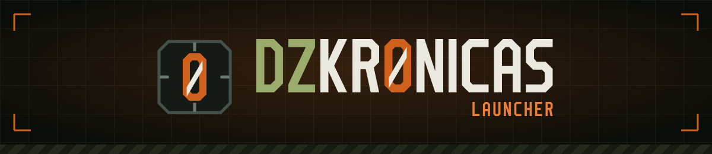
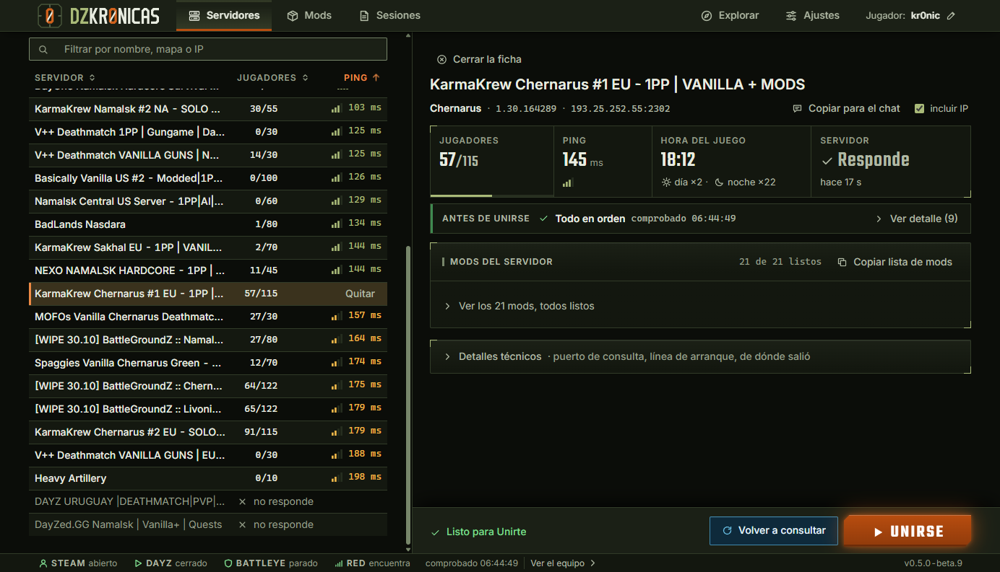
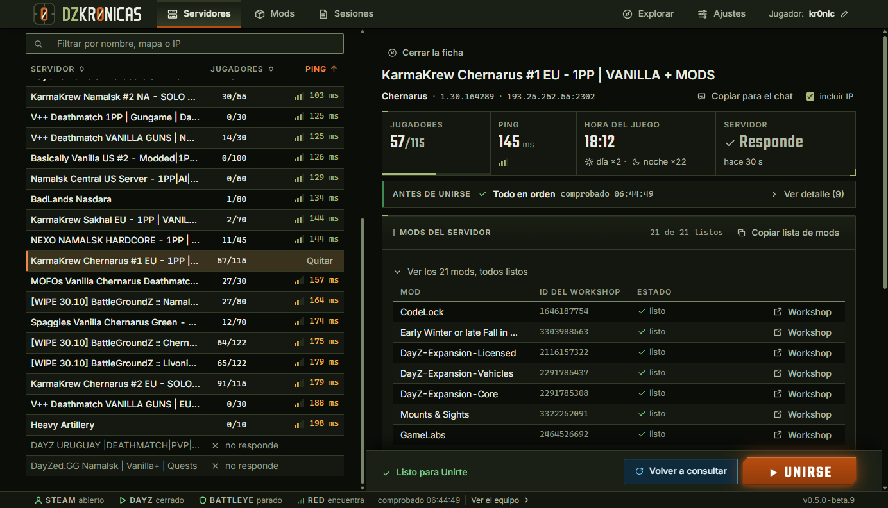
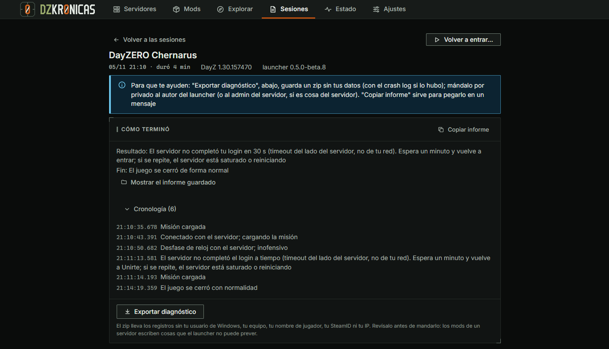
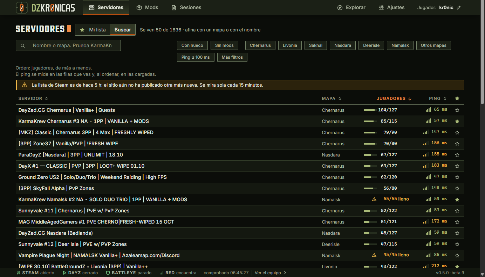
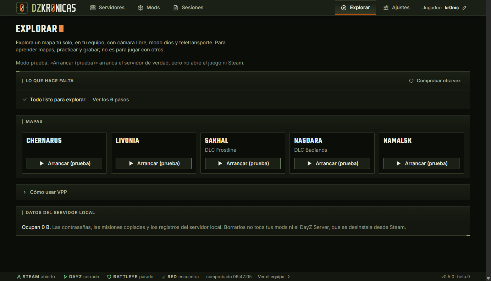
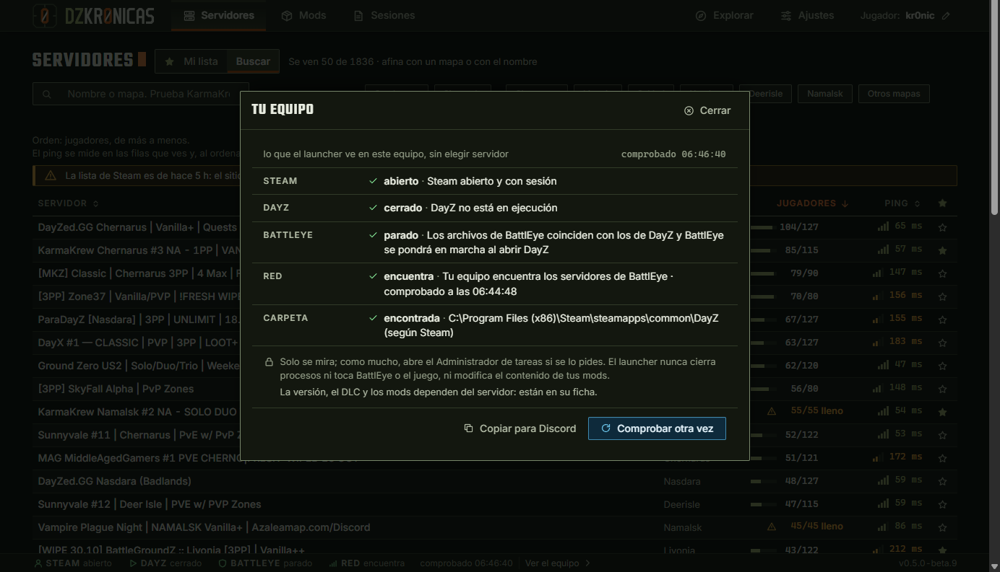
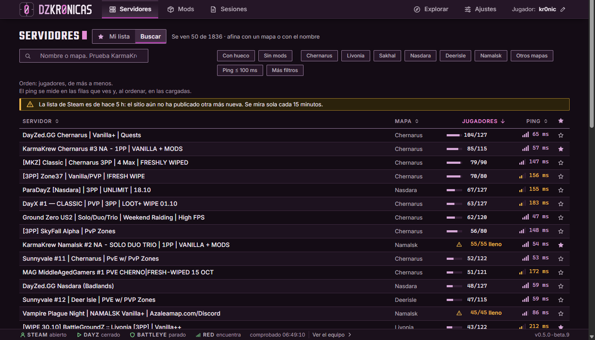

<p align="center">
  <a href="https://kr0nicas.github.io/DZKr0nicasLauncher-web/">
    
  </a>
</p>

<h1 align="center">Eliges servidor. Entras.</h1>

<p align="center">
  Un launcher de <b>DayZ</b> para Windows, hecho por un jugador.<br>
  Le pregunta al servidor qué mods pide <b>hoy</b>, los deja listos y arranca el juego ya conectado.<br>
  Si algo falla, te dice por qué.
</p>

<p align="center">
  <a href="https://github.com/kr0nicas/DZKr0nicasLauncher-web/releases/latest"></a>
  <a href="https://github.com/kr0nicas/DZKr0nicasLauncher-web/releases"></a>
  
  
</p>

<h3 align="center">
  <a href="https://github.com/kr0nicas/DZKr0nicasLauncher-web/releases/latest">⬇&nbsp; Descargar la beta</a>
  &nbsp;&nbsp;·&nbsp;&nbsp;
  <a href="https://kr0nicas.github.io/DZKr0nicasLauncher-web/">Ver la página</a>
  &nbsp;&nbsp;·&nbsp;&nbsp;
  <a href="https://github.com/kr0nicas/DZKr0nicasLauncher-web/discussions">Dudas e ideas</a>
  &nbsp;&nbsp;·&nbsp;&nbsp;
  <a href="#english">English</a>
</h3>

<p align="center">
  <a href="https://kr0nicas.github.io/DZKr0nicasLauncher-web/">
    
  </a>
</p>

<p align="center"><sub>Tu lista a la izquierda y la ficha a la derecha: el servidor responde, sus 21 mods están listos y no hay nada que impida entrar.</sub></p>

---

## Qué hace

<table>
  <tr>
    <td width="50%" valign="top">
      
      <h3>Antes de entrar, sabes qué te falta</h3>
      Al abrir un servidor le pregunta <b>en ese momento</b> qué mods pide y compara cada uno con los tuyos: instalado, por actualizar, falta o no publicado. Al pulsar <b>Unirse</b>, Steam baja lo que falte.
    </td>
    <td width="50%" valign="top">
      
      <h3>Si no entras, sabes por qué</h3>
      Lee el registro del juego y deja un informe <b>con palabras</b>: el servidor tardó en aceptarte, reiniciaba, tu versión no es la suya, faltaba un mod o el juego se cerró. <b>Copiar informe</b> y al Discord del servidor.
    </td>
  </tr>
  <tr>
    <td width="50%" valign="top">
      
      <h3>Servidores nuevos, filtrados en tu equipo</h3>
      Unos 2600 servidores de la lista de Steam, con filtros por hueco, mods, mapa y ping. <b>Viene apagado:</b> lo que escribes para buscar no sale de tu equipo.
    </td>
    <td width="50%" valign="top">
      
      <h3>Un mapa para ti solo</h3>
      Arranca un servidor de DayZ <b>en tu equipo</b> y te mete en él con cámara libre, modo dios y teletransporte. Para aprender el terreno o grabar sin que nadie te moleste.
    </td>
  </tr>
  <tr>
    <td width="50%" valign="top">
      
      <h3>Tu equipo, comprobado</h3>
      Steam, el juego, BattlEye, la red y la carpeta del juego, en una hoja que se abre desde la línea de abajo.
    </td>
    <td width="50%" valign="top">
      
      <h3>Dos cabinas: oliva o ciruela</h3>
      Dos temas oscuros, pensados para jugar de noche y para que se lean en un directo. En español y en inglés (beta).
    </td>
  </tr>
</table>

## Lo que nunca toca

| | |
| --- | --- |
| 🛡️ **No toca BattlEye** | El juego arranca con su BattlEye, como siempre. Solo mira si su servicio está en marcha. |
| 🎮 **No entra en el juego** | No inyecta nada ni lee su memoria. Solo lo arranca y mira si sigue abierto. |
| 📁 **No escribe en el juego ni en los mods** | De tu configuración solo cambia el vídeo y el mundo, cuando guardas en Ajustes, con el juego cerrado y dejando una copia. |
| 📡 **No manda nada por su cuenta** | Sin estadísticas, sin cuenta y sin informes automáticos. Lo que habla con internet se enciende a mano, en Ajustes › Red y privacidad. |
| 💸 **No cobra** | Hoy es gratis entero. Unirte con los mods correctos y entender cada fallo seguirán gratis siempre. |
| ⚖️ **Sin ventajas en el juego** | Nunca las habrá, ni venta de mods, ni anuncios. |

## Instalar

1. Baja `DZKr0nicasLauncher-Setup-<versión>-win-x64.exe` de la [última versión](https://github.com/kr0nicas/DZKr0nicasLauncher-web/releases/latest).
2. Comprueba su suma SHA-256 con la de `SHA256SUMS.txt`, en PowerShell:

   ```powershell
   Get-FileHash .\DZKr0nicasLauncher-Setup-*.exe -Algorithm SHA256
   ```

3. Ejecútalo. Si ya tenías una versión, va encima y tus datos se quedan.

> [!WARNING]
> **Windows te avisará al instalarlo.** El launcher aún no está firmado, así que Windows y algunos antivirus no lo conocen: «Más información» → «Ejecutar de todas formas». El aviso no dice qué hace el programa, solo que es nuevo. **No apagues Smart App Control ni añadas excepciones al antivirus por él;** si tu equipo no te deja instalarlo, no lo fuerces.

**Necesitas:** Windows 10 u 11 de 64 bits, y Steam abierto con DayZ instalado.

> [!NOTE]
> **Es una beta.** Está probada con servidores reales y le faltan jugadores que la pongan a prueba. Si algo falla, el informe de Sesiones te dice qué pasó y puedes copiarlo para contarlo en [Dudas, ideas y fallos](https://github.com/kr0nicas/DZKr0nicasLauncher-web/discussions).

---

<h2 id="english">English</h2>

**DZKr0nicasLauncher** is a DayZ launcher for Windows, made by a player. Pick a server and it asks that server which mods it requires **today**, gets them ready through Steam and starts the game already connected. If something fails, it tells you why in plain words.

- **Before you join, you know what is missing:** each mod shows as installed, needs update, missing or not published.
- **If you do not get in, you know why:** a report after every session, ready to copy for the server's Discord.
- **Search** about 2600 servers from the Steam list, filtered on your computer. Off by default.
- **Explore:** a local server just for you, with free camera, god mode and teleport.
- **It never touches** BattlEye, the game's memory, or the game and mod folders, and it sends nothing on its own.

Questions or bugs: [Discussions](https://github.com/kr0nicas/DZKr0nicasLauncher-web/discussions). English is a beta language: set it in **Settings › Appearance › Language**. [Download the latest version](https://github.com/kr0nicas/DZKr0nicasLauncher-web/releases/latest). It is unsigned for now, so Windows will warn you when installing.

---

<p align="center">
  <sub>
    Este repositorio lleva la <a href="https://kr0nicas.github.io/DZKr0nicasLauncher-web/">página</a> (<code>index.html</code> y capturas en <code>img/</code>, servidos con GitHub Pages, sin analítica ni scripts de fuera) y las <a href="https://github.com/kr0nicas/DZKr0nicasLauncher-web/releases">versiones para descargar</a>. El código del launcher está en otro repositorio, privado.<br>
    Las capturas son del launcher real, recortadas para quitar datos personales; el informe de Sesiones es un ejemplo, de una versión anterior.<br>
    Hecho por Kr0nicas, un jugador. Proyecto independiente: no está afiliado a Bohemia Interactive ni a Valve. DayZ y Steam son marcas de sus dueños.
  </sub>
</p>
